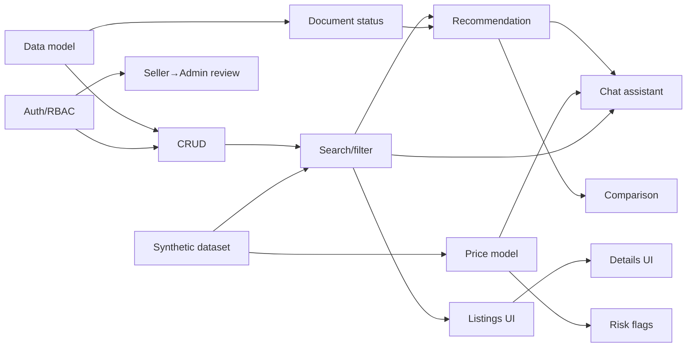
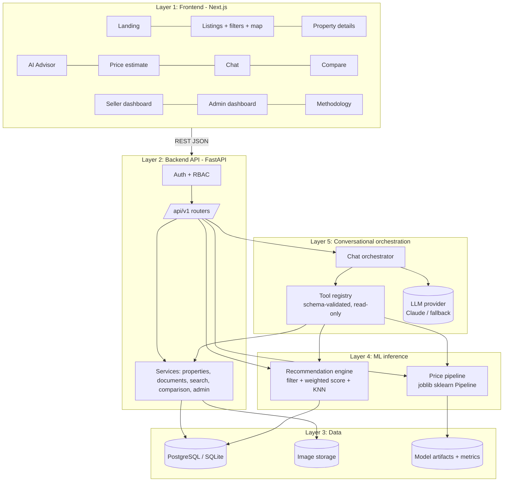
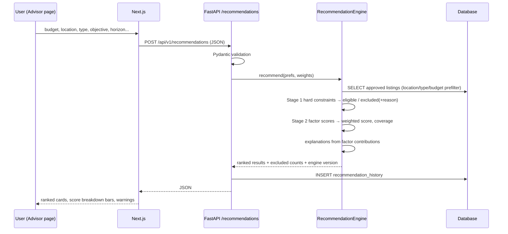
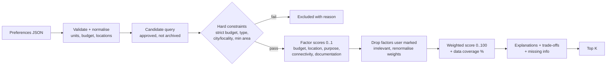
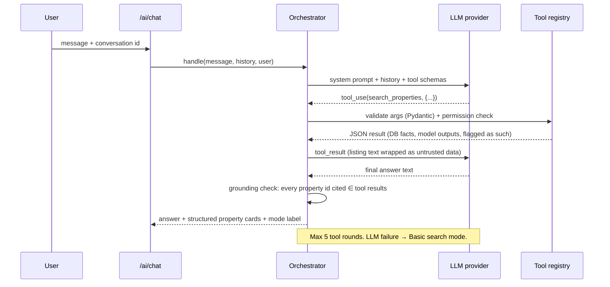

# PropWise AI: Technical Blueprint

**PropWise AI: An Intelligent Real Estate Discovery, Price Prediction and Property Recommendation System Using Artificial Intelligence and Machine Learning**

| | |
|---|---|
| Version | 1.0 (blueprint before implementation) |
| Date | 2026-10-14 |
| Scope | College mini-project, Hubballi–Dharwad (Karnataka) first, more cities later |
| Status legend | **MVP** = must ship, **REC** = recommended, **FUT** = future scope |

> **Data honesty rule for this whole document.** Every property record, price, and ML metric in the first versions of this project comes from a **synthetic data generator** and is labelled as such everywhere (database column, API field, UI badge, report). Nothing here claims to describe the real Hubballi–Dharwad market.

---

## Part A — Complete Project Understanding

### What we are building
A web platform where buyers and investors explore land and property listings in Hubballi–Dharwad, and get **three kinds of intelligent help** on top of normal search:

1. **An explainable recommendation engine** that takes structured preferences (budget, location, purpose, horizon, documentation and connectivity preferences), filters out listings that break hard constraints, and ranks the rest with a transparent weighted score. Every score is decomposed into factor contributions, and missing data is shown rather than hidden.
2. **A supervised ML price model** (regression) that estimates an *indicative asking-price range* for a property from its structured features, trained and evaluated against a baseline with MAE/RMSE/R²/MAPE reported in rupees.
3. **A conversational assistant** where an LLM turns natural language into *validated backend tool calls* (search, recommend, predict, compare, document info) and explains the returned records. The LLM is never the source of listings or prices.

Around this core sit the normal platform parts: listings with Indian land units, a map, property detail pages with document status, a comparison view, a seller dashboard, and an admin review queue.

### Who uses it
| Role | Main goals |
|---|---|
| Guest | Browse approved listings, search, filter, view map, use recommendation/prediction/chat |
| Buyer / Investor (registered) | Everything a guest can do, plus favourites and saved preferences |
| Seller / Contributor | Submit listings (stored as *pending*), upload photos, declare documents, edit own listings, see review status |
| Administrator | Approve/reject/flag listings, manage demo data, see platform statistics |

### What problem it solves
Small investors in tier-2 cities face scattered listings, confusing land categories (agricultural vs NA vs DC-converted), unclear document status (RTC, EC, Khata, conversion order), and no easy way to ask "what fits my ₹25 lakh, long-term, near Dharwad?". PropWise centralises listings, normalises their data, ranks them against the user's real constraints, and says clearly what still needs independent verification.

### Why AI is necessary
Users describe needs in free text ("₹25 lakh, farmland or plot, long term, Hubballi or Dharwad"). Turning that into structured filters, choosing the right backend operation, and explaining results in plain language is a natural-language problem. An LLM with tool calling handles it; rigid forms alone cannot.

### Why machine learning is necessary
Asking prices vary with locality, area, land class, conversion status and road access in a non-linear way. A regression model learns this mapping from data and gives a second opinion on a quoted price, which simple per-locality averages cannot do well when combinations are sparse. ML is the one component in the system that is genuinely **trained**.

### What makes it different from a regular property website
- Indian land semantics modelled correctly: property type, land classification, conversion status, layout approval, and document status are **separate fields**, never one blurred "category".
- Document status distinguishes *not provided*, *provided but unverified*, *verification pending*, *verified (only with a real process)*, *not applicable*, *unknown*. The system never declares a title "clear".
- Recommendations come with factor-level explanations and data-coverage warnings.
- Price estimates come with an empirically calibrated range, comparable listings, and a "synthetic demonstration model" warning.
- The chatbot is grounded: answers about properties come only from tool results, and any property ID in the answer is checked against those results.

### How it stays manageable
- One backend (FastAPI monolith with clean modules), one database, one frontend. No microservices, no vector DB, no message queue.
- SQLite works for a zero-install local demo; PostgreSQL via Docker for the "real" setup. Same ORM code for both.
- Weighted scoring (not a trained recommender) for ranking; KNN only for "similar properties".
- scikit-learn only for ML. XGBoost optional.
- The LLM is optional at runtime: a clearly labelled rule-based mode keeps search working without an API key.

---

## Part B — Final Feature Classification

### 1. Mandatory MVP features
| # | Feature | Module |
|---|---|---|
| M1 | Property data model with Indian units (sq ft, sq m, gunta, acre), decimal-safe price/area | A |
| M2 | Listing CRUD with ownership checks, archive instead of hard delete | A |
| M3 | Search, filters (all 13 in spec §7-B), sort (price, area, date, relevance), pagination, empty states | B |
| M4 | Property detail page with gallery, dimensions, classification, documents, map | UI |
| M5 | Document-status model (availability + verification, applicability per property type) | A |
| M6 | Seller submission → pending → admin approve/reject/flag → public | A, Workflow E |
| M7 | Authentication + role-based authorisation enforced in the API | Security |
| M8 | Synthetic demo dataset (~300 records), labelled synthetic, reproducible generator | Data |
| M9 | Content-based recommendation: hard-constraint filter + configurable weighted ranking + explanations | AI/ML 1 |
| M10 | Price regression pipeline: baseline, Linear Regression, Random Forest; leakage-safe split; metrics in INR; saved pipeline; prediction API | AI/ML 2 |
| M11 | Conversational assistant with validated tool calls and grounded answers; labelled fallback mode | AI 3 |
| M12 | Comparison of 2–3 properties with category-aware price-per-area warning | UI |
| M13 | Map view (Leaflet + OpenStreetMap, with attribution) | UI |
| M14 | About/Methodology page with limitations and disclaimers | UI |
| M15 | Automated tests: API, auth, recommendation, model, chat tools | Testing |
| M16 | README, setup, .env.example, OpenAPI docs, data dictionary | Docs |

### 2. Recommended features
| # | Feature | Depends on |
|---|---|---|
| R1 | KNN "similar properties" and comparison of KNN vs weighted ranking | M9, M10 features |
| R2 | Gradient Boosting (and optionally XGBoost) in the model comparison | M10 |
| R3 | Locality-aware (GroupKFold) evaluation and per-type/per-locality error analysis | M10 |
| R4 | Favourites and saved preferences | M7 |
| R5 | Recommendation history logging (anonymous session id allowed) | M9 |
| R6 | Small approved knowledge base for terminology (RAG-lite keyword retrieval, no vector DB) | M11 |
| R7 | Rule-based risk flags (missing key docs, price anomaly vs model, unknown access) | M5, M10 |
| R8 | Admin statistics dashboard with charts | M6 |
| R9 | Basic API rate limiting on AI endpoints | M11 |
| R10 | Docker Compose for Postgres + backend + frontend | M1 |

### 3. Optional future enhancements
Location investment scoring and K-Means locality clustering (FUT-1), OCR document extraction (FUT-2), time-series price trends when real history exists (FUT-3), saved searches and price alerts (FUT-4), PostGIS spatial queries (FUT-5), Supabase Auth/Storage swap-in (FUT-6), more cities (FUT-7), industrial property type (FUT-8), verified-agent workflow with a real verification process (FUT-9), mobile app (FUT-10), learned ranking from interaction data (FUT-11).

### Feature dependencies


---

## Part C — Technical Architecture

### Technology decisions (with defaults picked where the spec leaves a choice)
| Concern | Choice | Why / trade-off |
|---|---|---|
| Frontend | Next.js 14 (App Router) + React + TypeScript + Tailwind CSS, Recharts, Leaflet/react-leaflet | As specified. Hand-built accessible components on Tailwind (Radix-style patterns) rather than a heavy UI kit, to keep the bundle and learning curve small. |
| Backend | Python 3.11+, FastAPI, Pydantic v2, SQLAlchemy 2.0, Alembic | As specified. Python lets ML and API share code (the same feature builder is used in training and inference). |
| Database | **PostgreSQL 16** in Docker for the standard setup; **SQLite** fallback for zero-install demo and fast tests | Portable column types only (Numeric, String enums, JSON). PostGIS deferred (FUT-5): latitude/longitude are validated decimals and distances use the haversine formula in Python. |
| Auth | **Built-in JWT auth** (email + password, bcrypt hashing, short-lived access tokens, role claim checked server-side) | *Default picked instead of Supabase Auth*: it runs fully offline with no external account, which matters for a college demo and for tests. Auth is isolated in `app/core/security.py` + one dependency, so Supabase Auth can replace it later (FUT-6). |
| File storage | Local disk (`backend/storage/`), served through the API with validation | *Default picked instead of Supabase Storage*: no account needed. Storage is behind a small interface so a cloud bucket can be added later. |
| ML | pandas, NumPy, scikit-learn, Matplotlib, joblib | As specified. |
| LLM | **Anthropic Claude** via a provider-neutral `LLMProvider` interface; model name configurable by env var | Strong tool-calling support. Without `LLM_API_KEY` the assistant runs in a labelled **Basic search mode** (rule-based intent parser + same tools). An OpenAI adapter can be added behind the same interface. |
| Maps | Leaflet + OpenStreetMap tiles with attribution | Free for low-volume demo use; no bulk tile fetching. |
| Deployment | Local first. Optional: Vercel (frontend), Render/Railway (FastAPI), managed Postgres | No paid service needed to demonstrate. |

### High-level architecture


### Component interaction (recommendation request)


### Responsibilities
**Frontend:** rendering, client-side form validation (mirrors, never replaces, server validation), calling the API through one typed client (`lib/api.ts`), keeping a comparison tray and auth token, showing loading/empty/error states, and clearly badging *synthetic data*, *ML estimate* and *AI-generated text*.

**Backend:** all business rules, validation, auth and role checks, ownership checks, file validation, search query building, recommendation and ML inference, LLM orchestration and tool execution, logging recommendation requests, OpenAPI docs.

**Database:** persistent listings, users, documents, images, amenities, preferences, favourites, recommendation history, model metadata. Constraints enforce data sanity (positive prices, valid lat/long ranges, enum values).

### Recommendation pipeline


### Price prediction pipeline

```mermaid
flowchart LR
  R[Raw CSV<br/>data/raw] --> V[Schema validation] --> DUP[Duplicate & near-duplicate grouping]
  DUP --> CL[Cleaning, unit normalisation,<br/>missing values, outlier review]
  CL --> FE[Feature builder<br/>shared with API]
  FE --> SP[Group-aware train / val / test split]
  SP --> T[Train baseline, LinearReg,<br/>RandomForest, GBR]
  T --> EV[Evaluate MAE, RMSE, R², MAPE<br/>per type & locality]
  EV --> SEL[Select by validation MAE]
  SEL --> CAL[Residual quantiles → interval<br/>coverage checked on test]
  CAL --> SAVE[joblib pipeline + metadata JSON<br/>+ model_metadata row]
  SAVE --> API[POST /predictions/price]
```


### LLM orchestration workflow


---

## Part D — Database Blueprint

### Entities
`users`, `localities`, `properties`, `property_images`, `property_documents`, `amenities`, `property_amenities`, `user_preferences`, `favorites`, `recommendation_history`, `model_metadata`. (Raw data, training datasets and model files live on disk under `data/` and `ml/artifacts/`, not in the transactional DB; `model_metadata` points to them.)

### ER diagram
```mermaid
erDiagram
  users ||--o{ properties : "owns (owner_id)"
  users ||--o| user_preferences : has
  users ||--o{ favorites : saves
  users ||--o{ recommendation_history : requests
  localities ||--o{ properties : contains
  properties ||--o{ property_images : has
  properties ||--o{ property_documents : declares
  properties ||--o{ property_amenities : near
  amenities ||--o{ property_amenities : "is"
  properties ||--o{ favorites : "saved in"

  users { uuid id PK; string name; string email UK; string password_hash; string auth_provider_id; enum role; bool is_active; datetime created_at }
  localities { int id PK; string locality_name; string city; string district; string state; decimal center_lat; decimal center_lng; bool coordinates_approximate }
  properties { uuid id PK; uuid owner_id FK; int locality_id FK; string title; text description; enum property_type; enum intended_land_use; enum land_classification; enum conversion_status; enum layout_approval_status; numeric asking_price_inr; numeric area_value; enum area_unit; numeric normalized_area_sqft; numeric plot_width_ft; numeric plot_length_ft; numeric road_frontage_ft; enum road_access; bool is_corner_plot; numeric latitude; numeric longitude; string general_address; enum listing_status; text restriction_notes; text admin_notes; bool is_synthetic; string data_source; date last_verified_on; datetime created_at; datetime updated_at }
  property_images { int id PK; uuid property_id FK; string storage_path; string content_type; int ordering }
  property_documents { int id PK; uuid property_id FK; enum document_type; enum availability; enum verification_status; string storage_path; text verification_notes; string applicable_authority }
  amenities { int id PK; string code UK; string label; string category }
  property_amenities { uuid property_id FK; int amenity_id FK; numeric approx_distance_km; bool distance_is_synthetic }
  user_preferences { uuid user_id PK; numeric minimum_budget; numeric maximum_budget; json preferred_locality_ids; json preferred_property_types; enum objective; int investment_horizon_years; json other }
  favorites { uuid user_id PK; uuid property_id PK; datetime created_at }
  recommendation_history { int id PK; uuid user_id FK; string session_ref; json input_criteria; string engine_version; json result_property_ids; datetime created_at }
  model_metadata { int id PK; string model_name; string model_version; datetime training_date; string dataset_version; json feature_schema; json evaluation_metrics; bool trained_on_synthetic; bool is_active }
```

### Key constraints and indexes
- `asking_price_inr NUMERIC(14,2) CHECK (> 0)`; `area_value NUMERIC(14,4) CHECK (> 0)`; `normalized_area_sqft NUMERIC(16,4)` computed in the service layer from the original unit and never entered by users.
- `latitude NUMERIC(9,6) CHECK BETWEEN -90 AND 90`, `longitude NUMERIC(9,6) CHECK BETWEEN -180 AND 180` (service additionally checks a Karnataka bounding box for this deployment).
- Enums are stored as strings validated by Pydantic and a CHECK constraint, so adding a value is a migration, not a breaking DB type change.
- Unique: `users.email`, `amenities.code`, `(property_id, document_type)` on documents, `(locality_name, city)` on localities.
- Indexes: `properties(listing_status, property_type)`, `properties(asking_price_inr)`, `properties(normalized_area_sqft)`, `properties(locality_id)`, `properties(created_at)`, `properties(owner_id)`.
- FKs: `ON DELETE CASCADE` for images, documents, amenities links and favourites; properties are **archived** (`listing_status='archived'`), not deleted, by sellers.
- Ownership rule: only `owner_id` or an admin may modify a property; only admins may change `listing_status` to approved/rejected/flagged.
- Migrations: Alembic, one revision per milestone change, `alembic upgrade head` in setup. Seed data loaded by a script, never by a migration.

### Area units
Canonical unit is **square feet**. `1 acre = 43,560 sq ft`, `1 gunta = 1,089 sq ft` (40 guntas = 1 acre), `1 sq m = 10.763910 sq ft`. Original value and unit are always stored; normalised area uses `Decimal` arithmetic.

### Modelling land classification vs documents (the important part)
These are **five separate concepts** and are never merged:

| Field | Meaning | Values |
|---|---|---|
| `property_type` | What is being sold physically | `residential_plot`, `independent_house`, `agricultural_land`, `commercial_plot`, `commercial_building` (`industrial` = FUT-8) |
| `land_classification` | Land use as declared in revenue records (per seller) | `agricultural`, `non_agricultural_residential`, `non_agricultural_commercial`, `unknown` |
| `conversion_status` | Agricultural → non-agricultural conversion (DC conversion) as claimed | `converted_claimed`, `conversion_in_progress`, `not_converted`, `not_applicable`, `unknown` |
| `layout_approval_status` | Whether the plot is claimed to be in an approved layout | `approved_layout_claimed`, `unapproved_layout`, `not_applicable`, `unknown` |
| Document rows | Evidence the seller says they have, plus verification state | see below |

A claim is only a claim. "Converted (claimed)" means the seller declared a conversion order exists; whether the DC conversion order document is provided and whether anyone verified it lives in `property_documents`.

**Document types:** `rtc_pahani`, `mutation_record`, `encumbrance_certificate`, `khata`, `sale_deed`, `dc_conversion_order`, `layout_approval`, `building_plan_approval`, `commencement_certificate`, `completion_certificate`, `occupancy_certificate`, `rera_registration`.

**Two independent status columns per document:**
- `availability`: `provided`, `not_provided`, `not_applicable`, `unknown`
- `verification_status`: `unverified`, `pending`, `verified`, `not_applicable`

The UI shows one derived label: *Not provided*, *Provided – unverified*, *Verification pending*, *Verified*, *Not applicable*, *Unknown*. **`verified` is blocked in this prototype**: the API refuses to set it unless the setting `DOCUMENT_VERIFICATION_PROCESS_ENABLED=true` is on and an admin supplies a verification reference. It is off by default because no authorised verification process exists. An uploaded EC therefore always shows as "Provided – unverified", which is honest.

**Applicability rules** (drive the documentation-completeness score and checklists; documented as general guidance, not legal advice):
- Commencement/completion/occupancy certificates and building plan approval apply only to `independent_house` and `commercial_building` (built structures), not to vacant plots or farmland.
- DC conversion order applies to non-agricultural plots on land that was agricultural; not applicable to agricultural land sold as agricultural.
- Layout approval applies to plots in layouts (`residential_plot`, `commercial_plot`).
- RERA registration applies to registrable real estate projects (RERA Act 2016 §3 thresholds; to be confirmed against the Karnataka RERA site), recorded as `unknown` unless the listing is part of a project.
- RTC/Pahani, mutation, EC and sale deed are relevant to all land types; Khata to urban plots and buildings.

The **documentation completeness** score = provided applicable documents ÷ applicable documents (weighted: RTC, EC, sale deed, and conversion/layout where applicable count double). It measures *paperwork declared*, never legal safety.

---

## Part E — AI/ML Design

### What is trained and what is not
| Component | Category | Trained? |
|---|---|---|
| Listing CRUD, filters, auth, admin | Traditional software | No |
| Weighted suitability ranking | Algorithmic recommendation (rule-based, configurable weights) | **No** – weights are design assumptions |
| KNN similar-properties | Instance-based ML (fit on scaled features, no labels) | Fit, not supervised training |
| Price regression | **Supervised ML** | **Yes** – trained, validated, tested |
| Price interval | Empirical residual quantiles (split-conformal style) | Calibrated on validation set |
| Chat intent + explanations | Generative AI (external LLM) | Not trained by us |
| Basic search mode | Rule-based regex/keyword parser | No (labelled as such) |

### Recommendation algorithm
**Stage 1 (hard constraints)** – each is applied only when the user marks it mandatory:
- `max_budget` with `budget_strict=true` → `asking_price_inr ≤ max_budget`. If not strict, up to +10% over budget is allowed but scored down.
- `property_types` (if provided and not "flexible") → type ∈ set.
- `cities` / `locality_ids` with `location_strict=true`.
- `min_area_sqft` with `area_strict=true`.
- Always: `listing_status='approved'`.

Excluded listings are counted by reason and returned (`excluded_summary`), so "no matches" can say *why*.

**Stage 2 (suitability factors, each 0..1):**
| Factor | Default weight | Score |
|---|---|---|
| Budget | 30% | 1.0 when price is 60–100% of max budget (uses money well, leaves margin); linear decay below 60%; over budget (non-strict) decays to 0 at +10% |
| Location | 25% | 1.0 preferred locality; 0.7 preferred city but other locality; 0.3 other city in the region; uses straight-line distance where a reference point is given |
| Purpose suitability | 20% | Lookup table objective × (property type, land classification, conversion status). E.g. *build a house* → NA-residential plot in approved layout = 1.0, farmland = 0.1; *farming* → agricultural = 1.0; *long-term appreciation* → plots and farmland both moderate-high, with converted/approved layouts higher. Table lives in config and is shown on the Methodology page. |
| Connectivity | 15% | road_access ordinal (highway 1.0, main road 0.85, paved internal 0.65, unpaved 0.35, no direct 0.0); `unknown` = 0 and flagged |
| Documentation | 10% | documentation completeness (above); `unknown` documents count as not provided |

**Missing data and irrelevant criteria:** if the user sets a factor's importance to "doesn't matter", its weight is removed and the remaining weights are renormalised. If a factor matters but the listing lacks data, the factor scores **0** (no inflation) and is listed under *missing information*. A `data_coverage` percentage (share of weight backed by real fields) is returned next to every score.

**Score:** `score = 100 × Σ wᵢ·sᵢ / Σ wᵢ` over relevant factors. Ties break by documentation completeness then price. The score is labelled *"suitability score for your stated preferences — not a probability of investment success"*.

**Explanations** are generated from factor contributions: top two contributing factors become "why it matches"; any factor below 0.5 becomes a trade-off; missing fields and unverified key documents become "verify independently". Template text, so it is deterministic and testable; the LLM may rephrase it in chat but cannot change the numbers.

**KNN extension (REC):** standardised numeric features + one-hot categoricals → `NearestNeighbors(k=5, metric=euclidean)` for "similar properties" on the detail page, and an experiment comparing KNN retrieval (distance to a preference vector) with weighted ranking on the evaluation scenarios (overlap@5, constraint violations).

**Evaluation (no fake labels):** there are no genuine relevance labels, so we will not report Precision@K as if there were. Instead:
1. Constraint-satisfaction rate on ~15 scripted scenarios (must be 100%).
2. Hand-labelled scenario set: for each scenario, the expected *must-include* / *must-exclude* properties are derived from rules written before running the engine; report agreement, and clearly describe it as rule-derived.
3. Comparison against baselines: *cheapest first* and *newest first* — measure average purpose-suitability and documentation completeness of their top 5 vs ours.
4. Explanation correctness tests: every explanation claim must be true of the underlying record.
5. Stability: identical input → identical ranking; small weight perturbations → measured rank correlation (Kendall τ).

### Price prediction: features
Target: **`asking_price_inr` (observed asking price)**, modelled as `log(asking_price_inr)` to handle the wide range from ₹3 lakh plots to ₹3 crore farms; reported back in rupees.

Features (only those genuinely present in the data): `city`, `locality` (one-hot; rare localities grouped as "other" via `min_frequency`), `property_type`, `land_classification`, `conversion_status`, `layout_approval_status`, `road_access` (ordinal), `log_area_sqft`, `road_frontage_ft` (+ missing indicator), `is_corner_plot`, `amenity_count`, `distance_to_city_centre_km` (straight-line from approximate coordinates). No feature is added just to look sophisticated; feature importance (permutation) is reported.

### Training pipeline
1. **Load** raw CSV → **schema validation** (pandera-style checks implemented with pandas + Pydantic: types, enum values, ranges).
2. **Duplicate detection**: exact duplicates dropped; near-duplicates (same locality, area within 2%, price within 2%, same type) assigned one `dup_group_id`.
3. **Missing values**: numerical → median imputation + missing-indicator; categorical → `"unknown"` category. Report written to `ml/reports/data_quality.md`.
4. **Unit normalisation** to sq ft (shared `area_units.py`).
5. **Outlier review**: price-per-sq-ft by type, IQR rule → flagged and reported; removed only if clearly erroneous (e.g. area ≤ 0), never silently.
6. **Split**: `GroupShuffleSplit` on `dup_group_id` → 70% train / 15% validation / 15% test, seed 42. Additional **locality-aware GroupKFold** report to test generalisation to unseen localities. Synthetic data has no real time axis, so no time-based split (documented).
7. **Models**: `DummyRegressor(median)` baseline; per-locality-and-type median price-per-sqft baseline; `LinearRegression` (with one-hot + scaling); `RandomForestRegressor`; `GradientBoostingRegressor`. Small `GridSearchCV` on RF/GBR only (justified by data size).
8. **Select** by validation MAE (₹), then evaluate the winner **once** on test.
9. **Interval**: 10th and 90th percentile of validation log-residuals added to the prediction → *indicative 80% range*; coverage measured on the test set and reported. No invented confidence percentages.
10. **Persist**: the full sklearn `Pipeline` (preprocessing + model) via joblib, plus `metadata.json` (version, dataset hash, feature schema, metrics, `trained_on_synthetic=true`) and a `model_metadata` DB row.

### Evaluation strategy
MAE, RMSE, R² and MAPE in INR on the test set; comparison table versus both baselines; error by property type and by locality; residual plot and predicted-vs-actual plot (Matplotlib, saved PNGs from real runs only). Because data is synthetic, the report states plainly: *the model is recovering the generator's pricing rules; good metrics show the pipeline works, not that it knows the real market*.

### Example inference workflow
```
POST /api/v1/predictions/price
{ "city":"Dharwad", "locality_id":12, "property_type":"residential_plot",
  "land_classification":"non_agricultural_residential", "conversion_status":"converted_claimed",
  "layout_approval_status":"approved_layout_claimed", "area_value":30, "area_unit":"gunta"... }
→ validate → area 30 gunta = 32,670 sq ft → feature builder → pipeline.predict
→ { "predicted_asking_price_inr": "…", "indicative_range_inr": {"low":"…","high":"…","method":"empirical 10–90% validation residuals","measured_test_coverage":0.xx},
    "comparables":[...], "quoted_vs_estimate_pct": …, "top_factors":[...],
    "model": {"name":"random_forest","version":"…","trained_on_synthetic":true},
    "warnings":["Demonstration model trained on synthetic data. Not a valuation."] }
```

### How the LLM accesses backend tools
- Tools are Python functions registered with a Pydantic input model. The JSON schema sent to the LLM is generated from that model, and the LLM's arguments are re-validated with it before execution.
- Tools: `search_properties`, `get_property_details`, `recommend_properties`, `predict_property_price`, `compare_properties`, `get_document_information`, `get_location_summary` (counts and price statistics from our own listings only), `explain_term` (approved glossary).
- All tools are **read-only** and run with the caller's permissions (a guest cannot see pending listings or seller contact details).
- Listing text is passed inside a `<listing_data>` wrapper with an instruction that it is untrusted content, never instructions.
- After the final answer, a **grounding check** extracts property IDs/titles mentioned and verifies they appeared in tool results; failing answers are replaced with a safe templated answer.
- No SQL, no write tools, no access to secrets, max 5 tool rounds, timeouts, and graceful fallback.

---

## Part F — Data Strategy

### Dataset structure
`data/raw/` (as received, never edited) → `data/processed/` (cleaned, normalised) → `data/training/` (model-ready, versioned by hash) → `ml/artifacts/` (models). The same CSV schema is used for synthetic and genuine data; the DB seed reads `data/processed/properties.csv`.

Core CSV columns: `source_record_id, is_synthetic, data_source, source_url, collected_on, title, description, property_type, intended_land_use, land_classification, conversion_status, layout_approval_status, city, district, locality, latitude, longitude, coordinates_approximate, area_value, area_unit, plot_width_ft, plot_length_ft, road_frontage_ft, road_access, is_corner_plot, asking_price_inr, amenities, doc_<type>_availability …`.

### Potential lawful sources (to investigate, none assumed)
| Source | Use | Status |
|---|---|---|
| data.gov.in / Karnataka open data portals | Locality lists, census-style context | To check licences; unlikely to contain listings |
| Kaveri Online Services (Karnataka) – guidance values | Official guidance values could be a *separate* target type, never mixed with asking prices | Check availability and reuse terms; manual lookup only, no scraping |
| Karnataka RERA public project register | Real project names/registration for verification links | Link out only |
| Bhoomi (land records) | RTC/Pahani verification by users | Link out only, no automated access |
| Local owners/agents who consent | Small set of genuine listings with written consent | Best real-data route; mark `is_synthetic=false`, `data_source='contributed'` |
| Kaggle / research datasets (Indian housing) | Pipeline practice only | Different cities and mostly apartments; not used as Hubballi–Dharwad data |
| Third-party property portals | — | **Not scraped** (terms of service) |

Official portal URLs will be verified when the verification-links feature is built (Milestone 6) and recorded with the date checked.

### Synthetic dataset fallback (what we build now)
- `backend/scripts/generate_synthetic_data.py`, seed 42, ~300 records across ~20 Hubballi and Dharwad localities (locality *names* are real place names; their coordinates are approximate centroids and jittered).
- Prices come from a **documented synthetic formula**: synthetic base rate per locality × type multiplier × conversion/approval multiplier × road-access multiplier × area economies-of-scale × log-normal noise (σ≈0.15). The base rates are invented demo values, written in the script and the data dictionary as "synthetic, not market data".
- Every record: `is_synthetic=true`, `data_source='synthetic_generator_v1'`, title prefixed nowhere misleading, a "Demo data" badge in UI. Synthetic owners are demo accounts (`seller1@demo.propwise.example`), never real names.
- A few deliberately imperfect records (missing frontage, unknown road access, missing documents, a price outlier, near-duplicates) so cleaning, warnings and risk flags are actually exercised.

### Sample records (synthetic)
| title | type | locality | area | asking price | land class | conversion | road | docs |
|---|---|---|---|---|---|---|---|---|
| Demo: East-facing plot in approved layout | residential_plot | Navanagar, Hubballi | 1,200 sq ft | ₹18,40,000 | NA-residential | converted_claimed | paved_internal | RTC, EC, Khata provided (unverified) |
| Demo: Farmland with borewell | agricultural_land | Garag, Dharwad | 2 acre 10 gunta | ₹42,50,000 | agricultural | not_applicable | unpaved | RTC provided, EC not provided |
| Demo: Corner commercial plot | commercial_plot | Gokul Road, Hubballi | 2,400 sq ft | ₹61,00,000 | NA-commercial | converted_claimed | main_road | most provided, layout approval unknown |

### Data quality checks
Schema/enum validation, range checks (price, area, lat/long inside Karnataka box), consistency rules (agricultural land with `converted_claimed` and `agricultural` class flagged; plot width × length vs area within 10%), duplicates and near-duplicates, missing-value report per column, price-per-sq-ft outliers per type. Output: `ml/reports/data_quality.md` regenerated by the pipeline.

### Labelling synthetic records
DB columns `is_synthetic`, `data_source`; API field on every property; UI badge "Synthetic demo listing"; model metadata `trained_on_synthetic`; footer and Methodology page disclaimer.

### Limitations of a geographically focused dataset
Small sample (hundreds, not tens of thousands) → high variance and weak locality coverage; synthetic prices encode our assumptions, so the model cannot discover real market structure; no time dimension → no trend claims; models will not transfer to other cities without new data; locality coordinates are approximate.

---

## Part G — API Design

Base path `/api/v1`. JSON everywhere. Money and areas are serialised as **strings of decimals** (e.g. `"1840000.00"`) to avoid float rounding; frontend formats them as ₹ lakh/crore. Errors use one shape:
```json
{ "error": { "code": "validation_error", "message": "Human-readable summary", "details": [ { "field": "max_budget", "issue": "must be > 0" } ] } }
```
Status codes: 400/422 validation, 401 not authenticated, 403 not allowed, 404 not found, 409 conflict, 413 file too large, 415 unsupported file type, 429 rate limited, 503 dependent service (LLM/model) unavailable.

| Method & path | Auth | Rules / notes |
|---|---|---|
| `POST /auth/register` | none | name, email, password (≥8, letters+digits), role ∈ {buyer, seller}; admins created by CLI only |
| `POST /auth/login` | none | OAuth2 password form or JSON → `{access_token, token_type, user}` |
| `GET /users/me` | user | current profile |
| `GET/PUT /users/me/preferences` | user | saved advisor preferences |
| `GET /users/me/favorites`, `PUT/DELETE /users/me/favorites/{property_id}` | user | approved properties only |
| `GET /localities` | none | for filter dropdowns; `?city=` |
| `GET /meta/enums` | none | all enum values + human labels (single source of truth for the frontend) |
| `GET /properties` | optional | filters: `min_price, max_price, city, locality_id, property_type, land_classification, min_area_sqft, max_area_sqft, road_access, document_type (has provided), layout_approval_status, intended_land_use, q (text)`; `sort ∈ {price_asc, price_desc, area_asc, area_desc, newest, oldest}`; `page, page_size ≤ 50`. Guests and buyers see `approved` only; `mine=true` for sellers |
| `GET /properties/{id}` | optional | approved for everyone; pending/rejected only for owner/admin |
| `POST /properties` | seller/admin | creates `pending`; computes normalised area; documents optional |
| `PATCH /properties/{id}` | owner/admin | owner edits of an approved listing send it back to `pending` (re-review) |
| `DELETE /properties/{id}` | owner/admin | archives (soft delete) |
| `POST /properties/{id}/images` | owner/admin | jpeg/png/webp only, checked by magic bytes, ≤ 5 MB, ≤ 10 per property, random filenames |
| `PUT /properties/{id}/documents` | owner/admin | declare availability; only admin can move verification to `pending`; `verified` blocked unless process enabled |
| `GET /properties/{id}/similar` | none | KNN similar listings (REC) |
| `POST /properties/compare` | none | `{property_ids: [2..3], preferences?}` → aligned table + warnings |
| `POST /recommendations` | optional | preferences + optional weights → ranked results, excluded summary, engine version |
| `POST /predictions/price` | none | features or `property_id` → estimate, range, comparables, warnings; 503 if no model trained |
| `POST /ai/chat` | optional, rate-limited | `{message, conversation_id?, history?}` → `{answer, mode: "llm"|"basic_search", tool_calls:[names], properties:[cards], disclaimers}` |
| `GET /admin/properties?status=pending` | admin | review queue with completeness score |
| `POST /admin/properties/{id}/approve` / `reject` / `flag` | admin | reject/flag require a reason |
| `GET /admin/stats` | admin | counts by status/type/city, synthetic vs genuine |
| `GET /health` | none | DB reachable, model loaded, LLM configured (bool only) |
| `GET /model-info` | none | active model metadata + metrics |

Example:
```http
GET /api/v1/properties?city=Dharwad&property_type=residential_plot&max_price=2500000&sort=price_asc&page=1&page_size=12
```
```json
{ "items": [ { "id": "6f1c…", "title": "Demo: East-facing plot…", "property_type": "residential_plot",
   "asking_price_inr": "1840000.00", "area_value": "1200.0000", "area_unit": "sqft", "normalized_area_sqft": "1200.0000",
   "locality": {"id": 12, "name": "Saptapur", "city": "Dharwad"}, "documentation_completeness": 0.62,
   "is_synthetic": true, "cover_image_url": null } ],
  "page": 1, "page_size": 12, "total": 37, "total_pages": 4 }
```
FastAPI generates the full OpenAPI spec at `/docs` and `/openapi.json`; `docs/api.md` holds request/response examples for every endpoint.

---

## Part H — UI/UX Blueprint

### Navigation
Top bar: **PropWise AI** logo · Explore · AI Advisor · Price Estimate · Ask AI · Compare (with count badge) · Methodology · Sign in / avatar menu (Favourites, Seller dashboard, Admin). Mobile: hamburger drawer; a floating "Ask AI" button on every page. Footer: data disclaimer ("Listings on this demo are synthetic"), OSM attribution, legal/investment disclaimer.

### Pages and component hierarchy
```
app/
  page.tsx                 Landing: Hero(search box + "Ask AI" CTA) · CategoryTiles · FeaturedListings · HowItWorks(3 steps: discover, rank, verify) · DisclaimerBanner
  properties/page.tsx      Listings: FilterSidebar(drawer on mobile) · SortBar · ViewToggle(list|map) · PropertyGrid(PropertyCard) · Pagination · EmptyState
  properties/[id]/page.tsx Details: Gallery · PriceHeader(asking + ₹/sq ft + synthetic badge) · KeyFacts · LandLegalPanel(classification, conversion, layout) · DocumentChecklist · AmenityList · LocationMap · PriceEstimateCard(on demand) · SimilarListings · Actions(compare, favourite)
  advisor/page.tsx         AI Advisor: PreferenceForm(stepper) · ResultsList(RecommendationCard + ScoreBreakdown bars) · ExcludedSummary
  estimate/page.tsx        Price Estimate: FeatureForm · EstimateResult(range bar, quoted vs estimate, factors) · Comparables · ModelInfo
  chat/page.tsx            Chat: MessageList(user/assistant bubbles, PropertyMiniCards, ModeBadge) · SuggestedQuestions · Composer
  compare/page.tsx         Compare: CompareTable (2–3 columns, best value highlighted, category-mismatch warning) · optional preference profile for match scores
  seller/…                 MyListings table(status chips) · ListingForm(multi-section, unit picker, document declarations, image upload)
  admin/…                  ReviewQueue · ReviewDetail(completeness, risk flags, approve/reject/flag with reason) · StatsCharts(Recharts)
  about/page.tsx           Methodology, data sources, model card, limitations, disclaimers
  login, register
```

### Property card
Image (or neutral placeholder illustration, never a fake photo), *Synthetic demo* badge, title, locality · city, price in ₹ lakh/crore, area in original unit + sq ft, type chip, documentation meter ("4 of 7 key documents declared"), "View details".

### AI recommendation interface
Form: budget (₹ with lakh/crore helper), strict budget toggle, cities/localities multi-select, property types (or "Flexible"), objective (long-term appreciation, build a house, farming, commercial use, rental income), horizon (years), min area + unit, importance sliders for connectivity and documentation ("doesn't matter / somewhat / important"). Results: rank, card, **score /100 with stacked factor bar**, "Why it matches", "Trade-offs", "Verify independently", data-coverage chip, compare checkbox. Header: "N eligible of M listings; X excluded for budget, Y for type".

### Chat interface
Assistant messages carry a **mode badge** ("AI assistant" or "Basic search mode – AI unavailable"), inline property mini-cards linking to details, and tags on numbers: *Listing data*, *ML estimate*, *Suitability score*. Suggested questions under an empty chat. Errors show a retry.

### Price prediction result
Big estimate in ₹, horizontal range bar with the quoted price marker, "Quoted price is 12% above estimate", top factors, comparables table, and a yellow card: "Demonstration model trained on synthetic data. This is not a valuation or a guide to real Hubballi–Dharwad prices."

### Comparison interface
Columns per property; rows: asking price, area (original + sq ft), ₹/sq ft (with a warning when categories differ: "Farmland and residential plots are priced on different bases; per-sq-ft comparison can mislead"), locality, type, land classification, conversion, layout, road access, documentation completeness, match score for the chosen profile.

### Visual design
Neutral slate base, one teal-green brand colour, amber for warnings, clear status chips; Inter font; 8-pt spacing; cards with soft borders; WCAG AA contrast; keyboard-reachable controls and labelled inputs; skeleton loaders; friendly empty states with a suggested next action.

---

## Part I — Folder Structure

```
propwise/
├─ README.md                    setup, run, test, demo script
├─ docker-compose.yml           postgres (+ optional backend/frontend)
├─ .env.example
├─ docs/
│  ├─ BLUEPRINT.md              this file
│  ├─ REQUIREMENTS_CHECKLIST.md living checklist of every spec requirement
│  ├─ data_dictionary.md
│  ├─ api.md                    examples per endpoint
│  ├─ milestones/               status summary per milestone
│  └─ report/                   academic report material, viva Q&A
├─ data/
│  ├─ raw/                      as received / as generated
│  ├─ processed/                cleaned, normalised
│  └─ training/                 model-ready snapshots
├─ ml/
│  ├─ artifacts/                price_model.joblib, metadata.json, knn index
│  ├─ reports/                  data_quality.md, model_evaluation.md, plots/
│  └─ notebooks/                exploration (optional)
├─ backend/
│  ├─ requirements.txt, requirements-dev.txt, pytest.ini, alembic.ini
│  ├─ alembic/versions/
│  ├─ app/
│  │  ├─ main.py                app factory, CORS, error handlers, routers
│  │  ├─ core/                  config.py, security.py, errors.py, rate_limit.py
│  │  ├─ db/                    base.py, session.py
│  │  ├─ models/                SQLAlchemy models + enums.py
│  │  ├─ schemas/               Pydantic request/response models
│  │  ├─ api/v1/                routers: auth, users, properties, localities, meta, admin, recommendations, predictions, ai, system
│  │  ├─ services/              property_service, document_rules, area_units, search, comparison, storage
│  │  ├─ ml/                    features.py (shared), pricing.py (inference), recommendation/ (engine, factors, explain, knn)
│  │  └─ ai/                    orchestrator.py, providers/, tools.py, fallback_parser.py, glossary.py, prompts.py
│  ├─ scripts/                  generate_synthetic_data.py, seed_db.py, create_admin.py, train_price_model.py, evaluate_recommender.py
│  ├─ storage/                  uploaded images (git-ignored)
│  └─ tests/                    unit + API tests
└─ frontend/
   ├─ package.json, next.config.mjs, tailwind.config.ts, tsconfig.json
   ├─ src/app/                  pages listed in Part H
   ├─ src/components/           ui/, property/, advisor/, chat/, compare/, admin/
   ├─ src/lib/                  api.ts (typed client), types.ts, format.ts (₹ lakh/crore, units), auth.ts
   └─ tests/                    component tests (Vitest) + a Playwright smoke test
```

---

## Part J — Milestone-Based Implementation Plan

Each milestone ends with a status summary in `docs/milestones/` (completed functionality, files, tests actually run, open issues, next milestone).

### M1 — Backend foundation, database and demo data
- **Goal:** a running API with real persistence, auth, and listing workflows.
- **Work:** project skeleton, config, SQLAlchemy models + Alembic migration, enums and area-unit conversion, document applicability rules, synthetic data generator + seed script + admin CLI, auth (register/login/me), property CRUD/search/filter/sort/paginate, image upload validation, documents endpoint, admin approve/reject/flag/stats, localities and enums endpoints, health, error format, CORS.
- **Depends on:** blueprint.
- **Output:** `backend/`, `data/`, docker-compose, README.
- **Acceptance:** `alembic upgrade head` works on SQLite and PostgreSQL; seed loads ~300 synthetic listings; guests see only approved listings; seller → pending → admin approve → visible; all filters and sorts verified by tests.
- **Tests:** pytest for units, auth, authorisation, validation errors, pagination, filters, admin workflow, uploads.
- **Done when:** tests pass on both databases and OpenAPI docs load.

### M2 — Frontend platform (no AI yet)
- **Goal:** usable property-discovery site on the real API.
- **Work:** Next.js app, layout/nav, landing, listings with filters/sort/pagination/map, details with gallery/documents/map, login/register, seller dashboard + listing form + image upload, admin review queue + stats, comparison tray + page, methodology page skeleton.
- **Depends on:** M1.
- **Acceptance:** Workflows A and E work end-to-end in the browser; mobile layout works; empty/loading/error states present.
- **Tests:** type-check, lint, build, Vitest for format helpers and key components, Playwright smoke (browse → details).

### M3 — Price prediction model
- **Goal:** trained, evaluated, integrated regression model.
- **Work:** cleaning + quality report, feature builder, splits, baselines + LR + RF + GBR, tuning, evaluation report and plots, interval calibration, joblib pipeline + metadata, `/predictions/price`, `/model-info`, Estimate page and detail-page card, comparables.
- **Depends on:** M1 data.
- **Acceptance:** report shows real metrics vs baselines from an actual run; API loads the artifact; synthetic warning everywhere.
- **Tests:** reproducibility (same seed → same metrics), missing columns, invalid units, unseen categories, extreme areas, model loading, output schema.

### M4 — Recommendation engine and comparison
- **Goal:** explainable ranked recommendations.
- **Work:** hard-constraint filter, factor scorers, configurable weights, explanations, data coverage, history logging, KNN similar-properties, evaluation scenarios + baseline comparison script + report, Advisor page, compare endpoint with match scores.
- **Depends on:** M1, M2 (UI), M3 optional (for price-anomaly flag).
- **Acceptance:** demo scenario (₹25 lakh, residential, Hubballi/Dharwad, long-term) returns ranked, explained results; no constraint violations in any scenario.
- **Tests:** strict budget, type constraints, location matching, stability, missing attributes, explanation truthfulness, empty results.

### M5 — Conversational assistant
- **Goal:** grounded chat over real tools.
- **Work:** provider interface + Claude adapter, tool registry with schemas, orchestrator loop, injection-safe prompts, grounding check, glossary (approved definitions), Basic search mode parser, rate limiting, Chat page.
- **Depends on:** M3, M4.
- **Acceptance:** demo steps 12–15 work; without an API key the labelled fallback answers search/recommend/document questions.
- **Tests:** tool selection (with a scripted fake provider), invalid IDs, no matches, provider failure, prompt injection in a listing description, unauthorised requests, price question with no model.

### M6 — Hardening, documentation and academic material
- **Goal:** demonstrable from a clean setup.
- **Work:** risk flags, verified official-portal links, integration tests, responsive polish, full README, `docs/api.md`, data dictionary, report sections, demo script for the 15-step scenario, viva Q&A, limitations.
- **Acceptance:** fresh clone → documented commands → full demo works; every checklist item marked done or explicitly deferred.

---

## Part K — Constraints and Risks

| Risk | Impact | Mitigation |
|---|---|---|
| No genuine Hubballi–Dharwad dataset | Model cannot reflect the real market | Synthetic generator with documented formula; identical schema for genuine data; CSV import path; consented contributions; honest labelling |
| Low or misleadingly high accuracy | Overclaiming in viva | Baselines, group-aware splits, locality-held-out evaluation, explicit statement that synthetic metrics validate the pipeline only |
| Synthetic-data limitations | Model learns our own assumptions | Say so in the model card; show feature importance; never present as market insight |
| Legal information accuracy | Users mistake claims for verification | Separate claim/document/verification fields, `verified` disabled, "verify independently" lists, link to official portals, legal disclaimer |
| LLM API cost | Bills during development | Small model by default, max tokens and tool rounds capped, rate limiting, fake provider in tests, fallback mode without a key |
| AI hallucination | Invented listings/prices | Tools are the only data source, grounding check on cited IDs, templated safe answer on failure, tests with injected descriptions |
| Integration complexity | Frontend/backend drift | `/meta/enums` as single source of enums, typed API client, contract tests, consistent field names across DB/API/UI/ML |
| Development time | Unfinished core | Milestones in dependency order, MVP first, recommended features only after M5, optional ones listed as future scope |
| Map tile usage policy | Blocked tiles | Low-volume demo only, attribution, configurable tile URL |
| Windows local setup | Students struggle with Postgres | SQLite default for quick start, Docker Compose for Postgres, step-by-step README |

---

## Part L — Implementation start

See `docs/milestones/M1-backend-foundation.md` for the first milestone's commands, environment, what was implemented, and the tests that were actually run.
