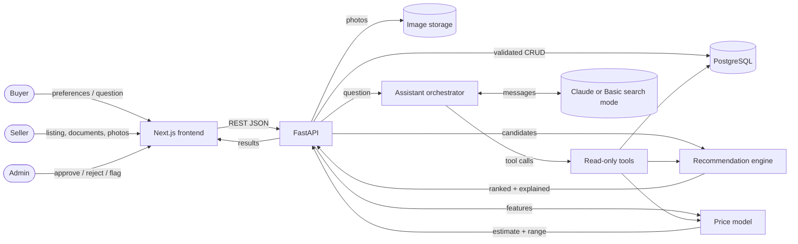
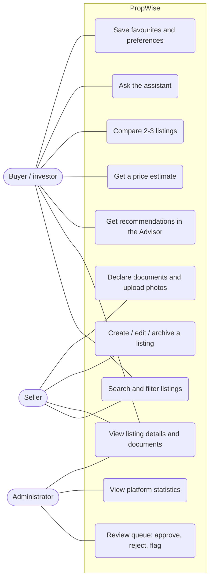

# Report material

This is source material for the academic report, following the 33 sections listed in specification §23. Each section
gives draft text or points to the file that holds the detail, so figures can be copied from the generated reports
rather than retyped. Every number here comes from an actual run. Items marked **To do** are the ones you need to
supply yourself: references you have read, and screenshots.

## 1. Project title
**PropWise AI: An Intelligent Real Estate Discovery, Price Prediction and Property Recommendation System Using AI and ML**

## 2. Abstract
PropWise AI is a web platform for property discovery in Hubballi–Dharwad, Karnataka. It stores residential plots,
houses, agricultural land and commercial property in one normalised schema. Land classification, conversion, layout
approval and document declarations are kept as separate facts.

On a reproducible synthetic dataset of 306 listings, a Linear Regression model on log price reached a test MAPE of
15.2%, against 46.1% for a locality-median baseline, though it generalised poorly to unseen localities. A transparent
weighted recommender ranks listings against a buyer's preferences with per-factor explanations, and broke no strict
requirement across 15 test scenarios. A Claude-based assistant answers questions only through read-only tools, with a
check on the listings it cites, and a rule-based mode works without any API key.

The system is explicit about its limits: all data is synthetic, and no document is verified.

## 3. Introduction
Draft from BLUEPRINT Part A, "What we are building" and "Who uses it". Introduce the three roles (buyer or investor,
seller, administrator) and the four kinds of functionality the project separates (specification §22):

| Kind | In PropWise |
|---|---|
| Traditional software | Listings, search and filters, authentication, roles, seller and admin workflows |
| Algorithmic recommendation | Weighted, explainable ranking (`weighted-v1`) and KNN similar listings |
| Supervised machine learning | The trained and evaluated price regression model, the only trained component |
| Generative AI | The Claude assistant, which interprets questions and explains tool results |

## 4. Problem statement
A buyer with a budget and a purpose, such as "₹25 lakh, long-term investment, near Hubballi or Dharwad", has to
compare listings described in different units, with legal statuses that are easy to confuse and prices that are hard
to judge. Ordinary portals filter and sort, but do not rank by fit to a purpose, explain the ranking, or separate a
seller's claim from a verified fact.

## 5. Motivation
- Land is sold in guntas and acres as well as in sq ft.
- An agricultural classification, a conversion claim and an approved-layout claim are three different facts, and
  buyers often treat them as one.
- AI is useful here for natural-language questions and explanations; ML for indicative price checks.

See BLUEPRINT Part A, "Why AI is necessary" and "Why machine learning is necessary".

## 6. Objectives
1. One schema for five property types, with Decimal-safe units and prices.
2. Search, listing and review workflows for buyers, sellers and admins.
3. An evaluated price model with honest baselines and leakage-safe splits.
4. Explainable recommendations against stated preferences.
5. A grounded conversational assistant with a fallback that needs no AI.
6. Clear separation of claims from verification throughout.

## 7. Existing system overview
**To do:** write from your own survey of property portals and of Karnataka's land-record services: Bhoomi (RTC),
Kaveri (registration and EC), RERA Karnataka, and municipal khata. Describe what each offers; do not quote features
you have not checked.

## 8. Limitations of existing approaches
Points to develop, from your survey:
- Search is by filters and price, without ranking by the buyer's purpose.
- There is little or no explanation of why a listing is shown.
- Price indications come without method or uncertainty.
- Legal fields are mixed together, and a seller's claim reads like a fact.
- Generic chatbots can invent listings.

## 9. Proposed system
BLUEPRINT Part A, "What makes it different", and Part B, "Feature classification". In summary:
- an Advisor with weighted, explained ranking;
- a price estimate with a range, comparables and warnings;
- a comparison page with match scores;
- a tool-grounded assistant;
- document applicability by property type, with "verified" disabled;
- rule-based risk flags.

## 10. Scope of the project
- **In scope:** Hubballi and Dharwad, 21 localities, five property types, three roles, synthetic data.
- **Out of scope:** payments, real document verification, industrial property, scraping, price forecasting over time.
  See BLUEPRINT Part B.3 for future enhancements.

## 11. Feasibility analysis
- **Technical.** Open-source stack (FastAPI, scikit-learn, Next.js, PostgreSQL). Every module runs on a laptop with
  SQLite, and the full suite passes on PostgreSQL.
- **Economic.** Free tools and free Render hosting. The assistant needs no paid key; with a key, cost is bounded by
  the tool-round and rate limits.
- **Operational.** A Windows step-by-step setup in the README, and demo accounts.
- **Legal and ethical.** No scraping, synthetic data clearly labelled, no claim of verification, and disclaimers on
  every estimate and answer.

## 12. Functional requirements
`docs/REQUIREMENTS_CHECKLIST.md` lists every requirement from the specification with its status and milestone.

## 13. Non-functional requirements
- **Security:** the checklist's security section, and BLUEPRINT Part K.
- **Reliability:** a fallback mode for the assistant, and consistent error shapes.
- **Usability:** responsive layout, tested at phone width.
- **Reproducibility:** fixed seeds and dataset hashes.
- **Performance:** paginated search, indexed filters.

## 14. System architecture
BLUEPRINT Part C, "High-level architecture" (Mermaid diagram) and "Component interaction". In deployment, the
frontend forwards `/api/v1` to the API on the same origin (`DEPLOY.md`).

## 15. Technology stack
BLUEPRINT Part C, "Technology decisions".

| Layer | Technology |
|---|---|
| Frontend | Next.js 14, TypeScript, Tailwind, Leaflet with OpenStreetMap, Recharts |
| Backend | FastAPI, Pydantic v2, SQLAlchemy 2, Alembic |
| Database | PostgreSQL 16 (SQLite for local quick start) |
| ML | scikit-learn, pandas, joblib |
| AI | Anthropic Claude through a provider interface |
| Testing | pytest, vitest, Playwright |
| Hosting | Render (free tier) |

## 16. Data flow diagram

## 17. Use-case diagram

## 18. ER diagram
BLUEPRINT Part D, "ER diagram" (Mermaid).

## 19. Database design
BLUEPRINT Part D, "Entities", "Key constraints and indexes", "Area units" and "Modelling land classification vs
documents". Columns are in `docs/data_dictionary.md`. Migrations are in `backend/alembic/versions/`.

## 20. Dataset description
- **Generator:** `backend/scripts/generate_synthetic_data.py --n 300 --seed 42`, giving 306 rows: 300 generated plus
  6 injected near-duplicates, which test the cleaning step.
- **Coverage:** 21 localities across Hubballi and Dharwad, and five property types. Of the 306 seeded listings, 122 are
  residential plots, 93 agricultural land, 41 independent houses, 30 commercial plots and 20 commercial buildings.
- **Prices:** a documented formula with invented base rates (data dictionary, "synthetic rules"). Every row has
  `is_synthetic=true`.
- **Justification:** there is no lawful, consented Hubballi–Dharwad dataset available, and scraping portals is not
  permitted. BLUEPRINT Part F lists sources to investigate.

## 21. Data preprocessing
`ml/reports/data_quality.md`: 288 clean rows of 306, with 18 excluded and the reason for each.
- Unit normalisation to sq ft with `Decimal`.
- Removal of duplicates and near-duplicates.
- Missing-value handling: road frontage gets a missing flag; unknown categories are kept as "unknown".
- Log of price and area.
- One-hot encoding of categories inside the scikit-learn pipeline, fitted on training data only.

## 22. ML algorithms
- **Price model:** two baselines (overall median; locality + type median ₹/sq ft × area), then Linear Regression,
  Random Forest and Gradient Boosting on log price.
- **Recommendation:** a weighted content-based score with hard filters for strict requirements only. This is an
  algorithm, not a trained model.
- **Similar listings:** k-nearest neighbours.

See BLUEPRINT Part E.

## 23. Model training methodology
- `GroupShuffleSplit` on the near-duplicate group: 70/15/15, giving 200, 44 and 44 rows.
- Grid search with 5-fold group cross-validation on the training split.
- The model was selected by validation MAE, and the test set was used once, after selection.
- The 80% indicative range comes from the 10th–90th percentile of validation residuals.
- A separate check, GroupKFold by locality, tests performance on unseen localities.
- Script: `backend/scripts/train_price_model.py`.

## 24. Model evaluation
From `ml/reports/model_evaluation.md`, with plots in `ml/reports/plots/`.

| Test set (n=44) | MAE | MAPE | R² |
|---|---|---|---|
| Overall median baseline | ₹33.56 lakh | 91.9% | -0.003 |
| Locality + type ₹/sq ft baseline | ₹19.59 lakh | 46.1% | 0.653 |
| Linear Regression (selected) | ₹7.59 lakh | 15.2% | 0.963 |

- **Validation MAE, used for selection:** LR ₹7.85 lakh, GBR ₹10.32 lakh, RF ₹12.88 lakh.
- **Indicative 80% range:** covered 84.1% of the test rows.
- **Unseen localities:** LR ₹36.82 lakh against ₹21.19 lakh for the baseline. The baseline wins here; say so.

**Recommender**, from `ml/reports/recommender_evaluation.md` (15 scenarios, no relevance labels):
- 0 strict-requirement violations.
- Rule-derived ideal listings in the top 5: 100%, against 0% for cheapest-first and 13% for newest-first.
- Top-5 documentation completeness: 76%, against 62% and 58%.
- Kendall's tau 0.94 under ±20% weight changes.

## 25. AI assistant architecture
`docs/milestones/M5-assistant.md` and BLUEPRINT Part C, "LLM orchestration workflow".
- Nine read-only, schema-validated tools.
- A loop of at most 5 tool rounds.
- Tool output wrapped as `<listing_data>`, against prompt injection.
- A check that every listing id cited was returned by a tool.
- Basic search mode, which drives the same tools with a rule-based parser.

The assistant's retrieval is done through tools over the live database, rather than through a vector store
(specification §10.4). Every fact it can state therefore comes from a query whose result is also shown to the user as
cards.

## 26. System implementation
- **Folder structure:** BLUEPRINT Part I.
- **Key modules:**
  - `backend/app/services/` (listings, documents, risk flags, recommendations)
  - `backend/app/ml/` (features, training, inference, recommendation engine, KNN)
  - `backend/app/ai/` (provider, tools, orchestrator, Basic search mode)
  - `frontend/src/app/` (pages)
- **API:** `docs/api.md`.
- **Deployment:** `render.yaml` and `DEPLOY.md`.

## 27. Testing strategy and results
| Suite | Result (final run, 2026-10-18) |
|---|---|
| Backend pytest, SQLite, Python 3.11 | 132 passed |
| Backend pytest, PostgreSQL 16 | 132 passed |
| Frontend TypeScript and ESLint | clean |
| Frontend unit tests (vitest) | 11 passed |
| Browser tests (Playwright, production build and live API) | 17 passed, including the full 15-step demo |

Categories tested:
- units, auth, authorisation, validation, filters, pagination, the admin workflow, uploads;
- the model: reproducibility, missing columns, unseen categories, extreme areas, loading;
- the recommender: constraints, stability, explanation truthfulness, empty results;
- the assistant: fake provider, grounding, injection, invalid ids, provider failure, unauthorised access, rate limit.

Details are in each milestone summary. Not tested: a live Anthropic API call, and the Render deploy itself.

## 28. Application screenshots
**To do:** take these from the running app (local or Render), after seeding:
- Home
- Explore with filters, and the map view
- Listing details: documents, risk flags, price estimate, similar listings
- Advisor results
- Compare
- Estimate
- Chat, in both modes
- Seller dashboard and listing form
- Admin queue and stats
- Methodology
- One phone-width view

## 29. Results and discussion
- Relate each number above to what it does and does not show. Good price metrics on synthetic data validate the
  pipeline, not the market.
- The recommender behaves as specified, but buyer agreement is untested.
- The assistant cannot cite unseen listings.
- Use the walkthrough in `demo_script.md` as the narrative.

## 30. Limitations
`limitations.md`.

## 31. Future enhancements
BLUEPRINT Part B.3, plus:
- real, consented data and retraining;
- buyer feedback to learn the weights;
- a document-verification workflow with the issuing authorities;
- object storage for photos and private documents;
- more cities;
- price trends once dated transactions exist (forecasting, which this project deliberately does not do).

## 32. Conclusion
PropWise works end to end: listing, review, search, explained recommendations, indicative pricing, comparison and a
grounded assistant. It is explicit about what it knows. Its contribution is the pipeline and the explainable,
claim-aware design; claims about the real market would need genuine data.

## 33. References
**To do:** list only sources you have read. Candidates:
- the scikit-learn, FastAPI, Next.js and Anthropic API documentation;
- the official portals: landrecords.karnataka.gov.in, kaveri.karnataka.gov.in, rera.karnataka.gov.in,
  www.hdmc.mrc.gov.in;
- papers on hedonic pricing and content-based recommendation, from your literature survey.
