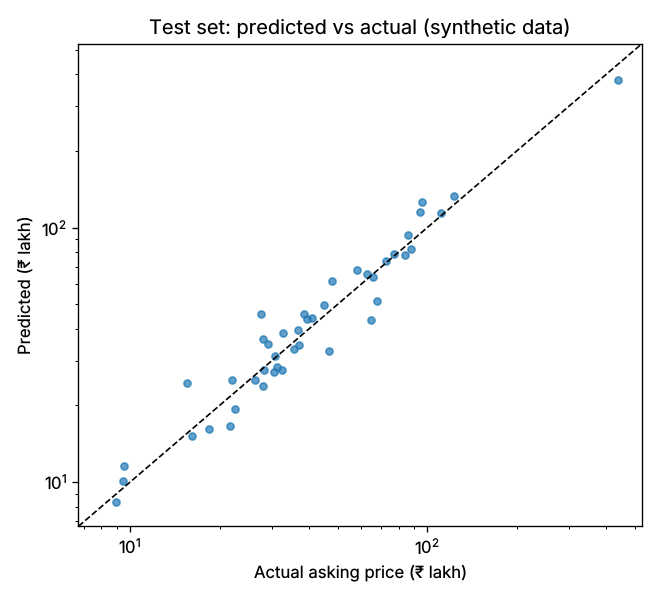
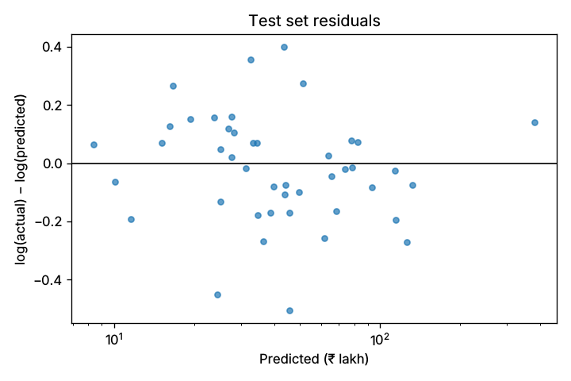
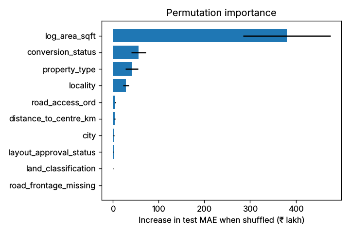

# Price model evaluation

Model version `20261014-f0c175ee-linear_regression`, trained 2026-10-14T09:08:13+00:00, seed 42.

> Trained on synthetic data generated by a documented formula. Good metrics show that the pipeline recovers the generator's pricing rules, not that it knows the real Hubballi–Dharwad market. Not a valuation.

**Target:** asking_price_inr (observed asking price, modelled as log; not a transaction price).  
**Data:** 288 clean rows from 306 raw (`data/raw/synthetic_properties_v1.csv`).  
**Split:** GroupShuffleSplit on near-duplicate group, 70/15/15: train 200, validation 44, test 44. Synthetic data has no real time axis, so there is no time-based split.  
**Selection:** lowest validation MAE (INR) among trained models; test set used once, after selection.

## Validation set (used to choose the model)
| Model | MAE | RMSE | R² | MAPE | Median APE |
|---|---|---|---|---|---|
| Baseline: overall median price | ₹28.73 lakh | ₹34.53 lakh | -0.010 | 95.2% | 58.5% |
| Baseline: locality + type median ₹/sq ft × area | ₹13.44 lakh | ₹19.64 lakh | 0.673 | 38.8% | 23.5% |
| Linear Regression | ₹7.85 lakh | ₹11.20 lakh | 0.894 | 17.0% | 14.0% |
| Random Forest | ₹12.88 lakh | ₹18.28 lakh | 0.717 | 26.8% | 22.2% |
| Gradient Boosting | ₹10.32 lakh | ₹15.36 lakh | 0.800 | 20.5% | 14.5% |

Selected: **Linear Regression**.

Grid search (5-fold group CV on the training split, scored by MAE):

- Random Forest: 8 combinations, best max_depth=12, max_features=1.0, min_samples_leaf=3 (CV MAE ₹18.52 lakh)
- Gradient Boosting: 8 combinations, best learning_rate=0.05, max_depth=2, n_estimators=400 (CV MAE ₹15.00 lakh)

Why a linear model can win here: the synthetic generator builds prices by *multiplying* a locality rate by type, conversion, layout and road factors and a power of area. Taking logs turns that into a sum, which is exactly what Linear Regression on log(price) fits. Tree models have to approximate the same structure in steps from only 200 training rows. Real prices need not follow this shape, so the ranking of models could change on genuine data.

## Test set (evaluated once, after selection)
| Model | n | MAE | RMSE | R² | MAPE | Median APE |
|---|---|---|---|---|---|---|
| Baseline: overall median price | 44 | ₹33.56 lakh | ₹65.16 lakh | -0.003 | 91.9% | 55.8% |
| Baseline: locality + type median ₹/sq ft × area | 44 | ₹19.59 lakh | ₹38.33 lakh | 0.653 | 46.1% | 20.8% |
| Linear Regression | 44 | ₹7.59 lakh | ₹12.57 lakh | 0.963 | 15.2% | 11.3% |

R² is computed on rupee values, so a few large farmland prices dominate it; MAPE and median APE are easier to read across ₹5 lakh plots and ₹1 crore farms.

## Indicative range
empirical 10th–90th percentile of validation log-residuals gives a nominal 80.0% range of ×0.77 to ×1.31 around the estimate. Measured coverage on the 44 test rows: **84.1%**. With so few rows this coverage figure is itself uncertain.

## Error by property type (test set)
| Type | n | MAE | MAPE | Median APE |
|---|---|---|---|---|
| residential_plot | 19 | ₹7.02 lakh | 18.8% | 14.8% |
| agricultural_land | 13 | ₹7.38 lakh | 12.5% | 6.8% |
| independent_house | 6 | ₹7.44 lakh | 9.4% | 8.2% |
| commercial_plot | 5 | ₹10.74 lakh | 17.1% | 11.9% |
| commercial_building | 1 | ₹6.25 lakh | 7.4% | 7.4% |

## Error by locality (test set)
Most localities have only a handful of test rows, so these numbers are noisy.

| Locality | n | MAE | MAPE |
|---|---|---|---|
| Byahatti | 5 | ₹7.41 lakh | 26.0% |
| Gokul Road | 4 | ₹12.63 lakh | 19.7% |
| Keshwapur | 4 | ₹6.78 lakh | 10.3% |
| Unkal | 4 | ₹8.45 lakh | 29.5% |
| Bhairidevarkoppa | 3 | ₹3.85 lakh | 8.9% |
| Garag | 3 | ₹2.07 lakh | 9.9% |
| Kusugal | 3 | ₹2.93 lakh | 13.2% |
| Mugad | 3 | ₹2.43 lakh | 11.2% |
| Old Hubballi | 3 | ₹3.53 lakh | 9.8% |
| Navanagar | 2 | ₹30.38 lakh | 10.1% |
| Rayapur | 2 | ₹1.74 lakh | 4.1% |
| Amminabhavi | 1 | ₹0.57 lakh | 6.4% |
| Gabbur | 1 | ₹2.90 lakh | 4.6% |
| Kelgeri | 1 | ₹21.31 lakh | 32.9% |
| Lakamanahalli | 1 | ₹16.19 lakh | 24.0% |
| Malmaddi | 1 | ₹20.23 lakh | 21.4% |
| Narayanpur | 1 | ₹3.16 lakh | 14.0% |
| Saptapur | 1 | ₹9.49 lakh | 7.7% |
| Sattur | 1 | ₹2.77 lakh | 2.5% |

## Unseen localities
GroupKFold (5 folds) by locality over all clean rows. The model never sees the test localities during training.

| Model | MAE | MAPE | Median APE |
|---|---|---|---|
| Baseline: locality + type median ₹/sq ft × area | ₹21.19 lakh | 45.7% | 27.9% |
| Linear Regression | ₹36.82 lakh | 84.7% | 42.9% |

Errors are much larger for localities absent from training. The model has no information about an unseen locality beyond its city and distance to the centre, so the API adds a warning when a locality was not in the training data. In this run the simple baseline, which falls back to the median ₹/sq ft of the property type, was more accurate than the trained model on unseen localities.

## Permutation importance (test set)
How much the test MAE rises when one feature's values are shuffled. Global, not per property.

| Feature | MAE increase | Std |
|---|---|---|
| log_area_sqft | ₹3.80 crore | ₹95.23 lakh |
| conversion_status | ₹56.35 lakh | ₹15.96 lakh |
| property_type | ₹41.53 lakh | ₹13.64 lakh |
| locality | ₹28.75 lakh | ₹5.96 lakh |
| road_access_ord | ₹5.46 lakh | ₹1.28 lakh |
| distance_to_centre_km | ₹3.92 lakh | ₹1.08 lakh |
| city | ₹2.31 lakh | ₹1.34 lakh |
| layout_approval_status | ₹1.72 lakh | ₹0.56 lakh |
| land_classification | ₹0.50 lakh | ₹0.60 lakh |
| road_frontage_missing | ₹0.20 lakh | ₹0.25 lakh |
| amenity_count | ₹0.01 lakh | ₹0.03 lakh |
| is_corner_plot | ₹0.00 lakh | ₹0.00 lakh |
| road_access_unknown | ₹-0.01 lakh | ₹0.01 lakh |
| road_frontage_ft | ₹-0.03 lakh | ₹0.76 lakh |

## Plots

## Library versions
python 3.13.16, scikit-learn 1.7.2, numpy 2.3.5, pandas 2.3.3
